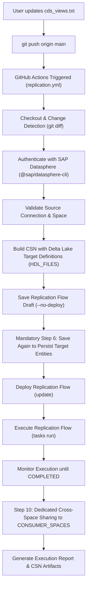

# Fully Automated SAP Datasphere Replication Flows

Automate end-to-end SAP Datasphere Replication Flows directly from Git commits using GitHub Actions. All operations execute remotely on GitHub-hosted runners with zero local computer execution.

---

## Architecture & Workflow



---

> [!IMPORTANT]
> **Data Lake File Storage Type Spaces (`HDL_FILES` / `DWC_HDLF`) & Target Local Tables:**
> In Data Lake File storage type spaces, target data is stored as **Delta Lake / Parquet files** in SAP HANA Data Lake Files (`DWC_HDLF`).
> - The pipeline creates and deploys **Local Table CSN entities** directly into your space before replication flow creation:
>   - **Active Entity `<VIEW>`:** Configured with `@DataWarehouse.delta: {type: ACTIVE}` and `@DataWarehouse.persistence.hdlf.tableFormat: DELTA_LAKE`.
>   - **Delta Entity `<VIEW>_Delta`:** Configured with `@DataWarehouse.delta: {type: UPSERT}`, extraction parameters (`EXTRACTION_MODE`, `FROM_VERSION`, `TILL_VERSION`), and CDC columns (`Change_Type`, `Change_Date`).
> - All column definitions parse and preserve source metadata (`nativeType` length/precision/scale and `TemplateType` date/time/timestamp).
> - Target objects in the Replication Flow bind directly to `<VIEW>_Delta` (`isNew: false`, `container: ""`).

---

## 1. CDS View Input

Input CDS Views via `cds_views.txt` in the root of the repository:

```text
# Enter one CDS View technical name per line.
# Blank lines and lines starting with '#' are ignored.

I_BILLINGFREQUENCY
I_BILLINGFREQUENCY_TEXT
I_CURRENCYTEXT
```

- **Format:** One CDS View name per line.
- **Consolidation:** All active CDS views are consolidated into a **single Replication Flow** (`RF_CONSOLIDATED` or custom `FLOW_NAME`).
- **Comments & Blank Lines:** Ignored automatically.
- **Change Detection:** Only newly added or changed CDS Views are processed in subsequent runs. Existing flows and targets are preserved.

---

## 2. GitHub Secrets & Variables Configuration

Configure your GitHub repository: **Settings** → **Secrets and variables** → **Actions**.

### Required Secrets (Repository Secrets)

| Secret Name | Description | Example |
| :--- | :--- | :--- |
| `DATASPHERE_HOST` | SAP Datasphere tenant host URL | `https://my-tenant.hcs.cloud.sap` |
| `CLIENT_ID` | OAuth 2.0 Client ID | `sb-clone-123!b456...` |
| `CLIENT_SECRET` | OAuth 2.0 Client Secret | `wXyZ123456...` |
| `AUTHORIZATION_URL` | OAuth 2.0 Authorization URL | `https://my-tenant.authentication.sap.hana.ondemand.com/oauth/authorize` |
| `TOKEN_URL` | OAuth 2.0 Token URL | `https://my-tenant.authentication.sap.hana.ondemand.com/oauth/token` |

### Required Variables or Secrets (Repository Variables)

| Variable Name | Description | Example | Default |
| :--- | :--- | :--- | :--- |
| `SOURCE_SPACE` | Technical ID of the source Datasphere space | `RAD_S3X` | *(Required)* |
| `CONSUMER_SPACES` / `CONSUMER_SPACE` | Technical ID of consumer space(s) to share tables to (comma-separated for multiple) | `RADH_S3X` | `""` (Local to source space) |
| `SOURCE_CONNECTION` | Technical ID of the source connection | `S3XReplicationflows` | *(Required)* |
| `SOURCE_CONTAINER` | Source container/namespace | `CDS_EXTRACTION` | `CDS_EXTRACTION` |
| `TARGET_CONNECTION` | Target connection technical ID | `DWC_HDLF` | `DWC_HDLF` |
| `FLOW_NAME` | Custom name for the consolidated Replication Flow | `RF_CONSOLIDATED` | `RF_CONSOLIDATED` |
| `LOAD_TYPE` | Replication load mode (`INITIAL` or `INITIAL_AND_DELTA`) | `INITIAL` | `INITIAL` |
| `STATUS_TIMEOUT_SEC` | Maximum seconds to wait for flow run completion | `600` | `600` |
| `STATUS_POLL_INTERVAL_SEC`| Seconds between status checks | `15` | `15` |

---

## 3. Official 10-Step Automation Sequence (Data Lake Files / HDL_FILES)

To guarantee 100% deployment reliability, target entity persistence, and cross-space data sharing in Data Lake File storage spaces (`HDL_FILES`), the pipeline follows an end-to-end 10-step sequence:

| Step | Operation | Implementation Detail |
| :--- | :--- | :--- |
| **1** | **Authenticate using Datasphere technical user** | Headless OAuth2 client credentials pre-fetch & `@sap/datasphere-cli login` |
| **2** | **Create or update Replication Flow** | Checks space for existing technical name & initializes consolidated flow |
| **3** | **Configure source objects** | Maps source CDS view columns, keys, and extraction container |
| **4** | **Deploy target Local Tables (CSN)** | Generates and deploys Delta Lake Local Tables (`<VIEW>` and `<VIEW>_Delta`) with parsed source metadata into the source space |
| **5** | **Save Replication Flow draft** | Binds flow tasks to target objects (`<VIEW>_Delta`, `isNew: false`) with `--no-deploy` |
| **6** | **Save again to persist target objects (Mandatory)** | Mandatory second save (`--no-deploy`) with server-read fallback to validate target persistence |
| **7** | **Deploy Replication Flow** | Deploys flow and active bindings via `update` (with `--deploy-anyway` fallback) |
| **8** | **Execute Replication Flow** | Triggers execution task via `datasphere tasks replication-flows run` |
| **9** | **Monitor replication status** | Polls `datasphere tasks replication-flows status` until `COMPLETED` |
| **10** | **Share Local Tables to Consumer Space(s)** | Dedicated sharing step: reads live deployed CSN from Datasphere, injects cross-space sharing for `CONSUMER_SPACES`, applies update, and verifies server persistence |

> [!TIP]
> **Why the Two-Stage Save (Step 5 & Step 6) is Mandatory for Target Persistence:**  
> In SAP Datasphere, target objects are created in draft mode during the initial save (Step 5). As stated in SAP's official notice: *"Now the objects are already created when the replication flow is saved. You need to save the replication flow once again before deploying it so that the new objects are included correctly."* Saving the flow a second time (Step 6) commits the newly created target objects so they are fully persisted in the Data Lake Files container before deployment.

---

## 4. Manual Execution & Overrides

You can trigger the workflow manually from the **Actions** tab in GitHub:
- Click **SAP Datasphere Replication Flows** → **Run workflow**.
- Check **Force replication of all CDS Views** to bypass git diff and re-replicate all views declared in `cds_views.txt`.
