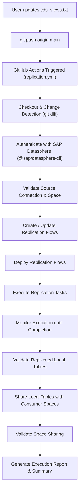

# Fully Automated SAP Datasphere Replication Flows

Automate end-to-end SAP Datasphere Replication Flows directly from Git commits using GitHub Actions. All operations execute remotely on GitHub-hosted runners with zero local computer execution.

---

## Architecture & Workflow



---

## 1. CDS View Input

Input CDS Views via `cds_views.txt` in the root of the repository:

```text
# Enter one CDS View technical name per line.
# Blank lines and lines starting with '#' are ignored.

I_SALESORDER
I_SALESORDERITEM
I_CUSTOMER
I_PRODUCT
```

- **Format:** One CDS View name per line.
- **Comments & Blank Lines:** Ignored automatically.
- **Change Detection:** Only newly added or changed CDS Views are processed in subsequent runs. Existing flows and tables are never deleted when a view is removed.

---

## 2. GitHub Secrets & Variables Configuration

Go to your GitHub repository: **Settings** → **Secrets and variables** → **Actions**.

### Required Secrets (Repository Secrets)

| Secret Name | Description | Example |
| :--- | :--- | :--- |
| `DATASPHERE_HOST` | SAP Datasphere tenant host URL | `https://my-tenant.hcs.cloud.sap` |
| `CLIENT_ID` | OAuth 2.0 Client ID | `sb-clone-123!b456...` |
| `CLIENT_SECRET` | OAuth 2.0 Client Secret | `wXyZ123456...` |
| `AUTHORIZATION_URL` | OAuth 2.0 Authorization URL | `https://my-tenant.authentication.sap.hana.ondemand.com/oauth/authorize` |
| `TOKEN_URL` | OAuth 2.0 Token URL | `https://my-tenant.authentication.sap.hana.ondemand.com/oauth/token` |

### Required Variables or Secrets (Repository Variables)

| Variable Name | Description | Example | Default |
| :--- | :--- | :--- | :--- |
| `SOURCE_SPACE` | Technical ID of the source Datasphere space | `SALES_SPACE` | *(Required)* |
| `SOURCE_CONNECTION` | Technical ID of the source connection | `S4HANA_CONN` | *(Required)* |
| `SOURCE_CONTAINER` | Source container/namespace | `CDS_EXTRACTION` | `CDS_EXTRACTION` |
| `CONSUMER_SPACES` | Comma-separated list of target spaces to share local tables | `ANALYTICS_SPACE,FINANCE_SPACE` | *(Optional)* |
| `LOAD_TYPE` | Replication load mode (`INITIAL` or `INITIAL_AND_DELTA`) | `INITIAL` | `INITIAL` |
| `STATUS_TIMEOUT_SEC` | Maximum seconds to wait for flow run completion | `600` | `600` |
| `STATUS_POLL_INTERVAL_SEC`| Seconds between status checks | `15` | `15` |

---

## 3. SAP Datasphere OAuth Setup

To generate the OAuth credentials:
1. Log in to your SAP Datasphere tenant as an Administrator.
2. In the left navigation, click **System** → **Administration** → **App Integration**.
3. Under **OAuth Clients**, click **Add a client**.
4. Set:
   - **Name:** e.g., `GitHub-Actions-CI`
   - **Purpose:** Interactive Usage / API
   - **Redirect URI:** `http://localhost:8080` (standard default)
5. Save and copy the **Client ID**, **Client Secret**, **Authorization URL**, and **Token URL** into your GitHub Repository Secrets.

---

## 4. Automated Execution Stages

Whenever `cds_views.txt` is committed and pushed to `main`:
1. **Change Detection:** Determines if any new CDS Views were added since the last commit (`git diff HEAD~1 HEAD`).
2. **Authentication:** Headless authentication using `@sap/datasphere-cli` with secure temporary credentials.
3. **Connection Validation:** Confirms that the target source connection exists in the source space.
4. **Plan Generation:** Formulates technical names and CSN definitions for Replication Flows and target Local Tables (`RF_<VIEW>`, `LT_<VIEW>`).
5. **Create / Update Flow:** Deploys the flow definition into SAP Datasphere using `datasphere objects replication-flows`.
6. **Execute:** Triggers task execution with `datasphere tasks replication-flows run`.
7. **Monitor:** Polls task status until `COMPLETED` (or flags timeout/failure).
8. **Validate Local Table:** Reads the generated local table definition to verify creation.
9. **Space Sharing:** Updates local table definitions with `sharing.targetSpaces` and pushes updates to Datasphere.
10. **Validate Sharing:** Reads back the table definition to confirm the table is shared with the requested consumer spaces.
11. **Reporting:** Publishes a Markdown summary to GitHub Actions (`$GITHUB_STEP_SUMMARY`) and saves JSON/Markdown reports as artifacts.

---

## 5. Manual Execution & Overrides

You can also trigger the workflow manually from the **Actions** tab in GitHub:
- Click **SAP Datasphere Replication Flows** → **Run workflow**.
- Check **Force replication of all CDS Views** to bypass git diff and re-replicate all views declared in `cds_views.txt`.
